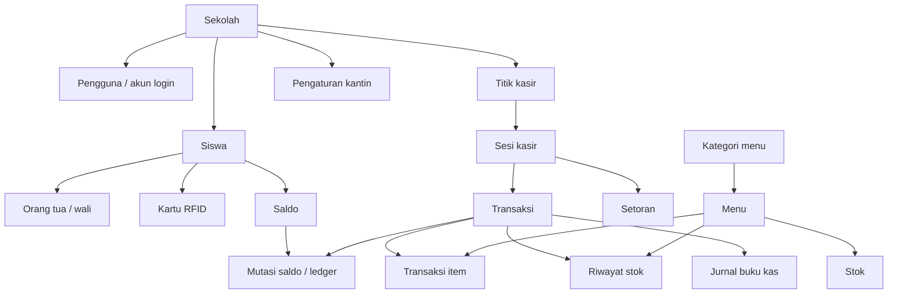

# Dokumentasi Skema Database Kantin Skoolia

> **Status: cetak biru (blueprint).** Dokumen + DDL di folder ini adalah **usulan skema v2** yang
> sudah diuji di database lokal. Belum menjadi migrasi Flyway — pemindahan ke
> `src/main/resources/db/migration/V28__*.sql` + penyesuaian entity dikerjakan di PR terpisah.

**Versi:** 2 (skema baru) · **Tanggal:** 12 November 2026 · **Acuan ERD:** [`erd-v2.mmd`](erd-v2.mmd)

---

## 1. Ringkasan

| | Skema lama | Skema baru |
|---|---|---|
| Jumlah tabel | 25 | **23** |
| Tabel induk sekolah | tidak ada | **ada** (`sekolah`) |
| Foreign key fisik | 5 | **52** |
| Constraint unik | sedikit | **16** |
| Tabel data siswa | 1 tabel campur (`dev_siswa_rfid`) | **2 tabel** (`siswa` + `kartu`) |
| Data orang tua | tidak ada | **ada** (`orang_tua`) |
| Fitur kartu tamu | ada | **dihapus** |
| Jurnal webhook | ada | **dihapus** |

Database sudah **dihapus dan dibuat ulang** dari nol, lalu diisi 2 sekolah. Semua uji konsistensi lolos (9/9).

---

## 2. Cara memakai

Semua file ada di [`sql/`](sql/):

| File | Isi |
|---|---|
| `00-reset.sql` | hapus semua objek lama |
| `01-skema-baru.sql` | 23 tabel + 52 FK + index |
| `02-seed.sql` | 2 sekolah + 12 akun + 19 siswa |
| `03-verifikasi.sql` | 9 uji konsistensi (read-only) |

```bash
# backup dulu, selalu
pg_dump -h localhost -U kantin -d kantin_db -f ~/kantin-backup/kantin_db_$(date +%Y%m%d_%H%M%S).sql

psql -h localhost -U kantin -d kantin_db -v ON_ERROR_STOP=1 -f docs/skema-v2/sql/00-reset.sql
psql -h localhost -U kantin -d kantin_db -v ON_ERROR_STOP=1 -f docs/skema-v2/sql/01-skema-baru.sql
psql -h localhost -U kantin -d kantin_db -v ON_ERROR_STOP=1 -f docs/skema-v2/sql/02-seed.sql
psql -h localhost -U kantin -d kantin_db -f docs/skema-v2/sql/03-verifikasi.sql
```

> Backup skema lama: `~/kantin-backup/kantin_db_SEBELUM_migrasi_*.sql` (217 KB, 25 tabel).

---

## 3. Alur data dalam satu gambar



Cerita satu transaksi (yang bisa diceritakan ke atasan):

1. **Siswa tap kartu** → sistem baca `kartu.uid` → ketemu `kartu.siswa_id` → ambil `siswa.nama`, `siswa.kelas`, `siswa.foto_url`.
2. **Cek saldo** → baca 1 baris `saldo` (kunci: sekolah + siswa). Tidak perlu menjumlah 188 baris ledger.
3. **Kasir simpan transaksi** → 1 baris `transaksi` + N baris `transaksi_item`.
4. **Saldo dipotong** → 1 baris `mutasi_saldo` (DEBIT) + `saldo.saldo` diperbarui. Ledger tetap utuh sebagai riwayat.
5. **Stok berkurang** → 1 baris `riwayat_stok` (KELUAR) + `stok.jumlah` diperbarui.
6. **Tutup sesi** → `sesi_kasir` diisi `uang_fisik` + `selisih`.
7. **Setor ke TU** → `setoran` dibuat `MENUNGGU_KONFIRMASI`, bendahara konfirmasi → `DIKONFIRMASI`.

Prinsipnya: **setiap angka punya dua tempat** — angka ringkas (untuk tampil cepat) dan riwayat (untuk audit). Keduanya dijaga konsisten oleh aturan database.

---

## 4. 23 tabel dalam 5 kelompok

| Kelompok | Tabel | Jumlah |
|---|---|---|
| 1. Identitas & referensi | `sekolah`, `pengguna`, `siswa`, `orang_tua`, `kartu` | 5 |
| 2. Katalog & stok | `kategori_menu`, `menu`, `stok`, `riwayat_stok` | 4 |
| 3. Operasional kasir | `titik_kasir`, `sesi_kasir`, `transaksi`, `transaksi_item`, `transaksi_tertunda` | 5 |
| 4. Uang | `saldo`, `mutasi_saldo`, `setoran`, `pengaturan_kantin` | 4 |
| 5. Pengawasan | `pembatasan`, `akun_buku_kas`, `jurnal_buku_kas`, `catatan_audit`, `kejadian_offline` | 5 |

### 4.1 Identitas & referensi

**`sekolah`** — induk semua data. Semua tabel lain punya `sekolah_id`.
| Kolom | Arti |
|---|---|
| `id` | ID sekolah, **sama dengan ID di admin-be** (1, 10) |
| `nama`, `npsn`, `alamat`, `aktif` | identitas sekolah |

**`pengguna`** — akun yang login ke aplikasi (kepsek, TU, pengelola, kasir, bendahara, admin).
| Kolom | Arti |
|---|---|
| `username` | unik **per sekolah** — `admin1` dan `admin10` boleh sama-sama ada |
| `peran` | `KEPSEK` / `TATA_USAHA` / `PENGELOLA` / `PETUGAS` / `BENDAHARA` / `ADMIN_SEKOLAH` |
| `password_hash` | bcrypt, bukan password asli |

**`siswa`** — data siswa (salinan dari admin-be, bukan sumber kebenaran NIS).
| Kolom | Arti |
|---|---|
| `id` | ID siswa, **sama dengan ID di admin-be** |
| `nis`, `nisn` | nomor induk; `nis` unik per sekolah |
| `foto_url` | URL foto, **pola sama dengan `menu.foto_url`** |

**`orang_tua`** — wali siswa. Dibuat tabel sendiri karena:
satu siswa bisa punya lebih dari satu wali (ayah, ibu, wali), masing-masing punya nomor HP sendiri dan status punya-aplikasi sendiri.

**`kartu`** — kartu RFID fisik.
| Kolom | Arti |
|---|---|
| `uid` | **nomor seri chip** (`04A1B2C3D4`) — ini yang dibaca mesin, jadi dijadikan primary key |
| `nomor_kartu` | label yang ditempel di kartu (`RFID-SISWA-101`) — untuk dibaca manusia |

> UID ≠ nomor kartu. Di data lama, 0 dari 26 kartu punya nilai yang sama, dan 142 dari 145 transaksi memakai UID.

### 4.2 Katalog & stok

**`kategori_menu`** → **`menu`** → **`stok`**: kategori membungkus menu, menu punya tepat 1 baris stok.

**`menu`** menyimpan `harga_jual`, `hpp`, `stok_minimum`, dan `foto_url`.
`stok` menyimpan jumlah terkini — dipisah supaya menu tidak ikut ter-update 300 kali sehari hanya karena stok berubah.

**`riwayat_stok`** adalah kartu stok: setiap perubahan stok jadi 1 baris (`MASUK`/`KELUAR`, `PEMBELIAN`/`PENJUALAN`/`PENYESUAIAN`/`RETUR`/`PEMBATALAN`), lengkap dengan `stok_setelah`.
`mutasi_asal_id` menunjuk baris asal kalau terjadi pembatalan — jadi tidak perlu menghapus riwayat.

### 4.3 Operasional kasir

**`titik_kasir`** — meja/device kasir (`DEMO1`, `FE10-1`).
**`sesi_kasir`** — buka/tutup kasir per titik per hari. Sekarang menyimpan `uang_fisik`, `selisih`, `catatan` (dulu dikirim FE lalu hilang).
**`transaksi`** — kepala struk. `metode_bayar` = `SALDO` atau `TUNAI`; kalau `SALDO`, `siswa_id` wajib terisi.
**`transaksi_item`** — rincian per menu; `nama_menu` ikut disimpan sebagai **salinan** supaya struk lama tetap benar walau menu di-rename.
**`transaksi_tertunda`** — transaksi yang menunggu konfirmasi (dulu `transaksi_menunggu_konfirmasi`).

### 4.4 Uang

**`saldo`** — 1 baris per siswa, **kunci gabungan** (`sekolah_id`, `siswa_id`).
Kenapa kunci gabungan: siswa bisa pindah sekolah, dan saldo harus tetap terikat ke sekolah tempat uangnya disetor.

**`mutasi_saldo`** — ledger: `KREDIT` (top up, refund) dan `DEBIT` (pembelian), dengan `saldo_setelah` di setiap baris.
`idempotency_key` mencegah top up yang sama masuk dua kali.

**`setoran`** — kasir menyetor uang ke TU. Punya `status` (`MENUNGGU_KONFIRMASI` → `DIKONFIRMASI`), `uang_fisik`, `selisih`, `konfirmasi_pada`.

**`pengaturan_kantin`** — 1 baris per sekolah: jam tutup otomatis, min/maks top up, batas saldo, kebijakan saldo mengendap (`REFUND` setelah 90 hari).
Tabel `kebijakan_kantin` yang lama dilebur ke sini supaya pengaturan tidak tersebar di dua tempat.

### 4.5 Pengawasan

**`pembatasan`** — gabungan 3 tabel lama (`blokir_kartu`, `blokir_item`, `limit_harian`) menjadi 1 tabel dengan kolom `jenis`.
Satu tabel karena semuanya pertanyaan yang sama: *"apakah siswa ini boleh belanja ini?"*

**`akun_buku_kas`** + **`jurnal_buku_kas`** — buku kas sederhana (dulu `pos_buku_kas` + `posting_buku_kas`).
**`catatan_audit`** — siapa mengubah apa. `entitas` + `entitas_id` menunjuk baris mana yang berubah, `nilai_lama`/`nilai_baru` menyimpan isinya.
**`kejadian_offline`** — catatan saat kasir kehilangan koneksi (dulu `insiden_offline`).

---

## 5. Aturan yang dijaga database sendiri

Bukan cuma di kode aplikasi — database menolak data yang salah:

| Aturan | Dijaga oleh | Hasil uji |
|---|---|---|
| Kartu sekolah 1 tidak bisa menempel siswa sekolah 10 | FK gabungan `(siswa_id, sekolah_id)` | **ditolak** |
| 1 siswa hanya 1 kartu aktif | unique index parsial | **ditolak** |
| 1 titik kasir hanya 1 sesi terbuka | unique index parsial | **ditolak** |
| Transaksi `SALDO` wajib punya siswa | check constraint | **ditolak** |
| Saldo tidak boleh minus | check constraint | **ditolak** |
| Menu sekolah 1 tidak bisa pakai kategori sekolah 10 | FK gabungan | **ditolak** |
| `LIMIT_HARIAN` wajib punya nominal | check bentuk per jenis | **ditolak** |
| Username ganda dalam 1 sekolah | unique | **ditolak** |
| Saldo selalu = total kredit − total debit | uji konsistensi | **0 selisih** |

Hasil lengkap: `psql -f 03-verifikasi.sql` → 9 uji, semua 0 temuan.

---

## 6. Apa yang berubah dari skema lama

### Tabel yang di-rename (biar namanya bisa ditebak)

| Lama | Baru | Alasan |
|---|---|---|
| `dev_siswa_rfid` | `siswa` + `kartu` | 1 tabel isinya 2 hal berbeda |
| `dev_pengguna` | `pengguna` | buang awalan `dev_` |
| `saldo_cache` | `saldo` | "cache" menyesatkan, ini data utama |
| `saldo_ledger` | `mutasi_saldo` | bahasa Indonesia, konsisten |
| `stok_cache` | `stok` | idem |
| `mutasi_stok` | `riwayat_stok` | beda jelas dari `mutasi_saldo` |
| `setoran_tu` | `setoran` | "TU" sudah jelas dari `dikonfirmasi_oleh` |
| `sekolah_kantin_config` | `pengaturan_kantin` | idem |
| `transaksi_menunggu_konfirmasi` | `transaksi_tertunda` | lebih pendek, sama arti |
| `pos_buku_kas` | `akun_buku_kas` | "pos" ambigu |
| `posting_buku_kas` | `jurnal_buku_kas` | "posting" itu aksi, bukan benda |
| `audit_log` | `catatan_audit` | konsisten bahasa |
| `insiden_offline` | `kejadian_offline` | idem |

### Tabel yang digabung
`blokir_kartu` + `blokir_item` + `limit_harian` → **`pembatasan`** · `kebijakan_kantin` → **`pengaturan_kantin`**

### Tabel yang dihapus
| Tabel | Alasan |
|---|---|
| `kartu_tamu` | tamu hanya bayar tunai, tidak perlu kartu & saldo |
| `webhook_event` | top up online di luar cakupan; isinya 3 baris, 2 di antaranya palsu |

### Tabel / kolom baru
`sekolah`, `siswa`, `orang_tua` · `siswa.foto_url`, `siswa.nis` · `transaksi.metode_bayar`, `transaksi.siswa_id` · `sesi_kasir.uang_fisik/selisih/catatan` · `setoran.status/uang_fisik/selisih/konfirmasi_pada`

---

## 7. Isi seed

### 7.1 Sekolah
| id | nama | NPSN |
|---|---|---|
| 1 | SMP Negeri 1 Skoolia | 20260001 |
| 10 | SMP Negeri 10 Skoolia | 20260010 |

### 7.2 Akun — 12 akun, password `Kantin#2026`

| sekolah | username | nama | peran |
|---|---|---|---|
| 1 | `kepsek1` | Wibisana Bama | KEPSEK |
| 1 | `tu1` | Sri Wahyuni | TATA_USAHA |
| 1 | `pengelola1` | Deryl Fabiensyah | PENGELOLA |
| 1 | `kasir1` | Ahmad Kasir | PETUGAS |
| 1 | `bendahara1` | Siti Rahma | BENDAHARA |
| 1 | `admin1` | Budi Santoso | ADMIN_SEKOLAH |
| 10 | `kepsek10` | Hendra Kusuma | KEPSEK |
| 10 | `tu10` | Rina Marlina | TATA_USAHA |
| 10 | `pengelola10` | Yusuf Hamdani | PENGELOLA |
| 10 | `kasir10` | Rizky Pratama | PETUGAS |
| 10 | `bendahara10` | Nurul Hidayah | BENDAHARA |
| 10 | `admin10` | Dewi Anggraini | ADMIN_SEKOLAH |

### 7.3 Siswa — 19 siswa, foto terisi

| sekolah | id | NIS | nama | kelas | kartu | saldo |
|---|---|---|---|---|---|---|
| 1 | 101 | 24250101 | Raka Aditya Pratama | 7A | `RFID-SISWA-101` | 85.000 |
| 1 | 102 | 24250102 | Nadia Safitri | 7A | `RFID-SISWA-102` | 50.000 |
| 1 | 103 | 24250103 | Bima Arya Nugraha | 7B | `RFID-SISWA-103` | 50.000 |
| 1 | 104 | 24250104 | Salsabila Putri | 7B | `RFID-SISWA-104` | 50.000 |
| 1 | 105 | 24250105 | Fajar Ramadhan | 8A | `RFID-SISWA-105` | 50.000 |
| 1 | 106 | 24250106 | Kirana Dewi Lestari | 8A | `RFID-SISWA-106` | 50.000 |
| 1 | 107 | 24250107 | Abizard | 8B | `RFID-SISWA-107` | 50.000 |
| 1 | 108 | 24250108 | Fajar Nugraha | 7B | `RFID-SISWA-108` | 50.000 |
| 1 | 109 | 24250109 | Citra Kirana | 8A | `RFID-SISWA-109` | 50.000 |
| 1 | 110 | 24250110 | Daffa Alfarizi | 9A | `RFID-SISWA-110` | 50.000 |
| 1 | 12 | 24250012 | Alya Rahmawati | 7C | `RFID-SISWA-012` | 50.000 |
| 1 | 13 | 24250013 | Bagas Saputra | 7C | `RFID-SISWA-013` | 50.000 |
| 1 | 201 | 24250201 | Rangga Pratama | 7A | `UJI-RFID-201` | 0 |
| 1 | 202 | 24250202 | Sinta Maharani | 7B | `UJI-RFID-202` | 0 |
| 10 | 1001 | 24251001 | Ahmad Fauzan | 7A | `RFID-SISWA-001` | 85.000 |
| 10 | 1005 | 24251005 | Citra Ayu Lestari | 7A | `RFID-SISWA-005` | 50.000 |
| 10 | 1006 | 24251006 | Dimas Prakoso | 7B | `RFID-SISWA-006` | 50.000 |
| 10 | 1007 | 24251007 | Eka Wulandari | 7B | `RFID-SISWA-007` | 50.000 |
| 10 | 3001 | 24253001 | Anisa Rahma | 7A | `UJI-RFID-3001` | 0 |

Semua siswa punya **2 wali** (ayah + ibu) = 38 baris `orang_tua`.
3 siswa terakhir sengaja `punya_aplikasi = false` agar tampilan "belum pakai aplikasi" ikut teruji.

### 7.4 Data lain
| Tabel | Isi |
|---|---|
| `kategori_menu` | 4 per sekolah (Makanan, Minuman, Snack, Alat Tulis) |
| `menu` + `stok` | 12 per sekolah, foto dari data lama |
| `titik_kasir` | 2 per sekolah (`DEMO1`, `DEMO2`, `FE10-1`, `FE10-2`) |
| `pengaturan_kantin` | 1 per sekolah |
| `akun_buku_kas` | 4 per sekolah |
| `saldo` + `mutasi_saldo` | 19 saldo, 16 mutasi (siswa bersaldo 0 tanpa mutasi) |
| `transaksi`, `sesi_kasir`, `setoran` | 0 — dibuat saat demo |

---

## 8. Kolom teknis di luar ERD

Tiga hal ini tidak digambar di ERD agar diagram tetap ringkas:

| Kolom | Di tabel | Kenapa perlu |
|---|---|---|
| `password_hash` | `pengguna` | tanpa ini tidak bisa login |
| `dibuat_at` / `created_at` | `sekolah`, `pengguna`, `siswa`, `kartu`, `menu`, `kategori_menu`, `titik_kasir` | jejak kapan data dibuat |
| `nama_menu` | `transaksi_item` | salinan nama saat transaksi, supaya struk lama tidak berubah kalau menu di-rename |

---

## 9. Dampak ke backend & langkah berikutnya

**Backend sekarang belum cocok dengan skema baru** — kode masih memanggil nama tabel lama.
Hasil pemetaan: **68 file** di `src/main/java` menyebut nama tabel lama.

| Nama lama | File terdampak |
|---|---|
| `saldo_ledger` | 15 |
| `mutasi_stok` | 9 |
| `posting_buku_kas` | 9 |
| `saldo_cache` | 8 |
| `stok_cache` | 7 |
| `audit_log` | 6 |
| `setoran_tu` | 4 |
| `kartu_tamu` | 4 |
| `dev_pengguna` | 3 |
| `blokir_kartu` | 3 |
| `limit_harian` | 3 |
| `kebijakan_kantin` | 3 |
| `webhook_event` | 3 |
| `dev_siswa_rfid` | 2 |
| `sekolah_kantin_config` | 2 |
| `blokir_item` | 2 |
| `transaksi_menunggu_konfirmasi` | 2 |
| `pos_buku_kas` | 2 |
| `insiden_offline` | 2 |

Urutan pekerjaan yang disarankan:

1. **PR 1** — dokumentasi + file SQL ini (tidak menyentuh kode).
2. **PR 2** — rename entity/repository BE ke nama tabel baru + hapus fitur tamu & webhook.
3. **PR 3** — isi 5 kekurangan yang dulu tidak tersimpan (uang laci, status setoran, NIS/foto, orang tua, nama petugas).
4. **Issue FE #135** — sesuaikan frontend setelah PR 2 & 3 merge.

Catatan saat menjalankan BE lagi: Flyway akan mencoba membuat ulang tabel lama dari `V1..V27`. Untuk sementara jalankan dengan `--spring.flyway.enabled=false`, sampai PR 2 mengganti migrasinya.

---

## 10. Pertanyaan yang sering muncul

**Kenapa `sekolah` harus jadi tabel sendiri?**
Karena 24 tabel lama menyimpan `sekolah_id` tanpa induk. Tidak ada yang mencegah `sekolah_id = 999` yang tidak ada sekolahnya. Sekarang semua `sekolah_id` punya FK.

**Kenapa `saldo` kuncinya dua kolom?**
Saldo terikat ke sekolah tempat uang disetor. Kalau siswa pindah sekolah, saldo lama tetap di sekolah asal, dan di sekolah baru saldonya mulai dari 0 — bukan pindah sendiri.

**Kenapa UID jadi primary key `kartu`, bukan `id`?**
Yang dibaca mesin adalah UID. Kalau pakai `id` buatan sendiri, setiap tap harus mencari dulu. Dengan UID sebagai PK, tap = 1 kali cari langsung.

**Kenapa `orang_tua` bukan kolom di `siswa`?**
Satu siswa bisa punya ayah, ibu, dan wali. Kalau dijadikan kolom, jumlahnya harus dibatasi dan nomor HP-nya tidak bisa dibedakan.

**Kenapa kartu tamu dihapus?**
Tamu bayar tunai, tidak punya saldo dan tidak butuh kartu. Fiturnya hanya menambah 7 constraint dan 0 baris data.

**Kenapa `webhook_event` dihapus?**
Top up online di luar cakupan kantin (yang mengurus saldo siswa adalah admin-be). Tabelnya berisi 3 baris, 2 di antaranya event palsu yang tidak pernah diproses kode mana pun.

**Kalau data lama masih dibutuhkan?**
Ada di `~/kantin-backup/kantin_db_SEBELUM_migrasi_*.sql`. Restore: drop schema lalu `psql -f` file itu.
